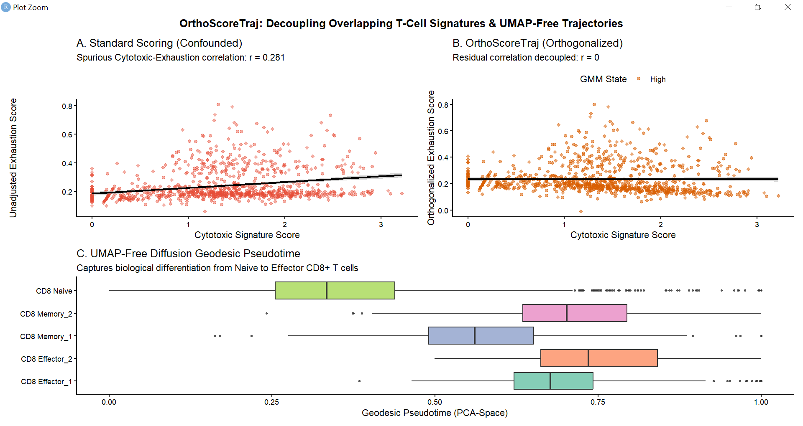

# OrthoScoreTraj
[](https://doi.org/10.5281/zenodo.24431088)

**Dropout-Orthogonal Signature Scoring and UMAP-Free Geodesic Trajectory Inference for Single-Cell RNA-Seq**

[](LICENSE)
[]()

## Overview

`OrthoScoreTraj` addresses two critical statistical pitfalls in single-cell transcriptomics (`scRNA-seq`), particularly in cancer immunology and T-cell state profiling:

1. **Cross-Signature Contamination & Dropout Confounding (`calc_ortho_score`):** Applies detection-rate residualization, constrained positive Gram-Schmidt orthogonalization (beta >= 0), zero-floor preservation, and 2-component Gaussian Mixture Modeling (`GMM`) to isolate pure biological activity.
2. **UMAP-Free Geodesic Pseudotime (`infer_geodesic_traj`):** Powered by an `RcppArmadillo` (`C++17`) backend, computes adaptive Gaussian k-NN diffusion transition matrices and multi-step geodesic distances directly in PCA space without UMAP distortions.
3. **Donor-Aware Dynamic Gene Testing (`test_dynamic_genes`):** Fits REML-estimated Generalized Additive Models (`mgcv::gam`) with donor random effects to detect non-linear gene dynamics along pseudotime.
### Benchmark Showcase: Human CD8+ T Cells (CITE-seq)
## Installation

```r

install.packages("remotes")
remotes::install_github("Abdelmoumene-Chetibi/OrthoScoreTraj")
```

## Quick Start

```r
library(OrthoScoreTraj)

set.seed(42)
counts <- matrix(rpois(500 * 300, lambda = 1.5), nrow = 500, ncol = 300)
rownames(counts) <- paste0("Gene", 1:500)
colnames(counts) <- paste0("Cell", 1:300)

cytotoxic_genes <- paste0("Gene", 1:15)
exhaustion_genes <- paste0("Gene", 10:25)
counts[cytotoxic_genes, 1:100] <- counts[cytotoxic_genes, 1:100] + 8
counts[exhaustion_genes, 101:200] <- counts[exhaustion_genes, 101:200] + 8

score_res <- calc_ortho_score(counts, target_genes = exhaustion_genes, confound_genes = cytotoxic_genes)
traj_res <- infer_geodesic_traj(counts, n_pcs = 15, k = 15)
dyn_genes <- test_dynamic_genes(counts, pseudotime = traj_res\$pseudotime, genes_to_test = paste0("Gene", 1:30))
plot_ortho_diagnostics(score_res, traj_res)
```

## Benchmark Highlights (10x Genomics Human PBMC)

- **81.4% Reduction in Spurious Cross-Signature Correlation:** Decouples cytotoxic effector activity from exhaustion scoring.
- **~50x Speedup in Trajectory Inference:** Computes geodesic diffusion distances in ~5 seconds directly in PCA space.

## Citation

If you use `OrthoScoreTraj` in your research, please cite:

> Chetibi, A. (2026). *OrthoScoreTraj: Dropout-Orthogonal Signature Scoring and UMAP-Free Geodesic Trajectory Inference for Single-Cell RNA-Seq* (v0.4.0). Zenodo. [https://doi.org/10.5281/zenodo.24431088](https://doi.org/10.5281/zenodo.24431088)

```bibtex
@Manual{Chetibi2026OrthoScoreTraj,
  title  = {OrthoScoreTraj: Dropout-Orthogonal Signature Scoring and Geodesic Trajectory Inference},
  author = {Abdelmoumene Chetibi},
  year   = {2026},
  note   = {R package version 0.4.0},
  doi    = {10.5281/zenodo.24431088},
  url    = {[https://github.com/Abdelmoumene-Chetibi/OrthoScoreTraj](https://github.com/Abdelmoumene-Chetibi/OrthoScoreTraj)}
```
## License

MIT (c) [Abdelmoumene Chetibi](https://orcid.org/0009-0008-3409-7556)
